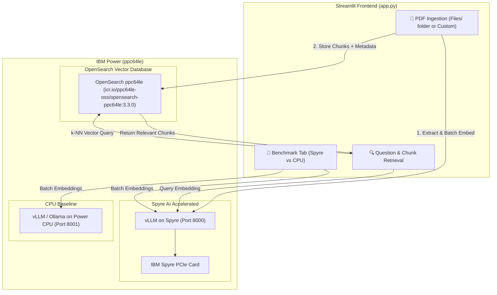

# VectorDB Lab on IBM Power (ppc64le)

This lab demonstrates how to host an OpenAI-compatible embedding model on IBM Power (using **vLLM** with IBM Spyre acceleration or Ollama/CPU) and integrate it with **OpenSearch** (running official `ppc64le` container images) as a Vector Database for PDF ingestion, semantic search, and high-throughput vector benchmarking.

---

## Lab Data Assets (`./Files`)

The lab includes reference PDFs located in `./Files`:
1. `Files/spyre_redbook.pdf` — IBM Spyre Accelerator Redbook / Technical Guide.
2. `Files/hybrid_cloud.pdf` — Hybrid Cloud Architecture on IBM Power.

---

## Architecture Overview



---

## Prerequisites

1. **Linux on Power (`ppc64le`)** or local testing environment.
2. **Docker / Podman** installed.
3. **Python 3.10+**

---

## Quickstart

### 1. Start OpenSearch Vector Database (`ppc64le`)
We use the official IBM Container Registry OpenSearch images built for `ppc64le`:
* `icr.io/ppc64le-oss/opensearch-ppc64le:3.3.0`
* `icr.io/ppc64le-oss/opensearch-ppc64le:3.5.0`

Pull the image and start via Docker/Podman Compose:
```bash
docker pull icr.io/ppc64le-oss/opensearch-ppc64le:3.3.0
docker compose up -d
```
OpenSearch runs on `http://localhost:9200` with the k-NN plugin enabled.

### 2. Start Inference Servers on IBM Power

#### Option A: Start vLLM with IBM Spyre Acceleration (Port 8000)
```bash
vllm serve BAAI/bge-small-en-v1.5 \
  --host 0.0.0.0 \
  --port 8000
```

#### Option B: Start Power CPU Baseline Server (Port 8001)
Run a second instance for CPU comparison:
```bash
vllm serve BAAI/bge-small-en-v1.5 \
  --device cpu \
  --host 0.0.0.0 \
  --port 8001
```

### 3. Run Streamlit UI
```bash
pip install -r requirements.txt
streamlit run app.py
```

Open your browser at `http://localhost:8501`.

---

## Lab Features & Workflow

1. **📥 Ingest PDFs & Documents**:
   - **One-Click Ingestion of `./Files`**: Automatically reads `Files/spyre_redbook.pdf` and `Files/hybrid_cloud.pdf`, splits them into overlapping passages with sliding window chunking, generates embeddings on Spyre, and bulk-indexes into OpenSearch with page numbers and document metadata.
   - **Upload Custom PDFs**: Support for additional user documents.

2. **🔍 Ask Questions & Retrieve Chunks**:
   - Suggested preset prompts for Spyre and Hybrid Cloud topics.
   - Retrieves top-k relevant chunks with similarity score cards, page numbers, and latency metrics.

3. **🚀 Benchmark (Spyre vs CPU)**:
   - Benchmark using real extracted PDF chunks from `./Files` or synthetic batches.
   - Compare throughput (`chunks/sec`) and latency (`ms/chunk`) between Spyre and CPU.

4. **⚙️ Index Admin**:
   - Create, verify, or reset the OpenSearch k-NN index.
