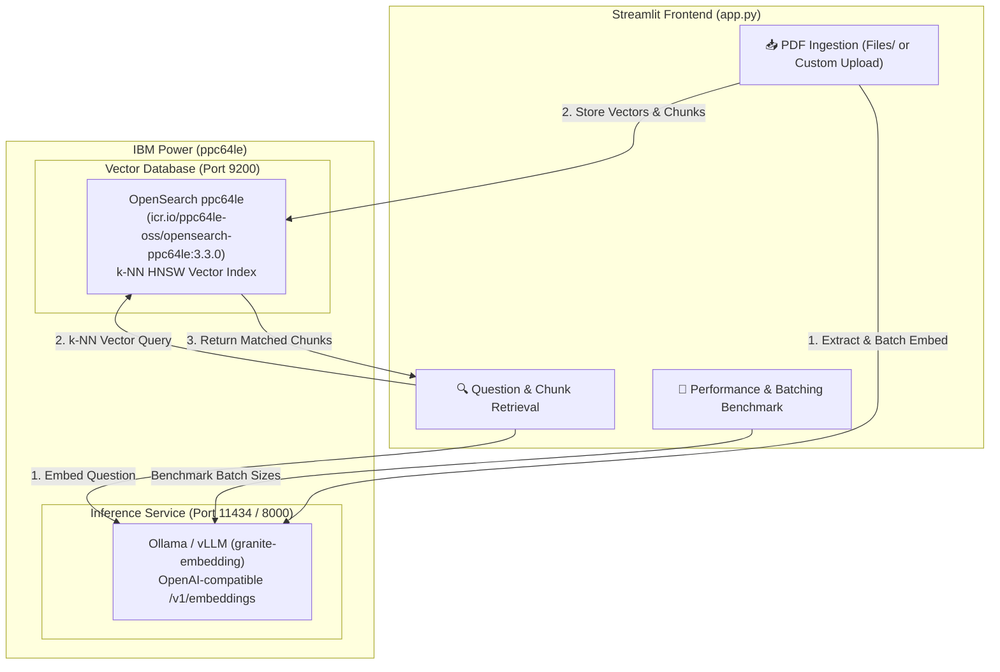

# VectorDB Lab on IBM Power (ppc64le)

This lab demonstrates how to host an OpenAI-compatible embedding model on IBM Power (`ppc64le`) using **Ollama** (or **vLLM** with IBM Spyre acceleration) with **IBM Granite Embeddings**, and integrate it with **OpenSearch** as a Vector Database for PDF ingestion, semantic search, and performance benchmarking.

---

## Lab Data Assets (`./Files`)

The lab includes reference PDFs located in `./Files`:
1. `Files/spyre_redbook.pdf` — IBM Spyre Accelerator Redbook / Technical Guide.
2. `Files/hybrid_cloud.pdf` — Hybrid Cloud Architecture on IBM Power.

---

## Architecture Overview



---

## Prerequisites

* **Linux on Power (`ppc64le`)** (RHEL 9 / SLES)
* **Podman** installed
* **Python 3.9+** with virtual environment

---

## Step-by-Step Setup

### 1. Start OpenSearch Container (`ppc64le`)

Pull and start the official IBM Container Registry OpenSearch container:

```bash
podman run -d \
  --name opensearch-vectordb \
  -p 9200:9200 \
  -p 9600:9600 \
  -e "discovery.type=single-node" \
  -e "DISABLE_SECURITY_PLUGIN=true" \
  -e "OPENSEARCH_JAVA_OPTS=-Xms2g -Xmx2g" \
  -v opensearch-data:/usr/share/opensearch/data:Z \
  icr.io/ppc64le-oss/opensearch-ppc64le:3.3.0
```

Verify OpenSearch is running:
```bash
curl http://localhost:9200
```

---

### 2. Start Ollama with IBM Granite Embedding

Start the Ollama container on `ppc64le` and pull the `granite-embedding` model:

```bash
# Start Ollama container
podman run -d \
  --name ollama-granite \
  -p 11434:11434 \
  -v ollama-data:/root/.ollama:Z \
  icr.io/ppc64le-oss/ollama-ppc64le:v0.32.7

# Pull IBM Granite Embedding model
podman exec -it ollama-granite ollama pull granite-embedding
```

*(Alternatively, run vLLM on Spyre: `vllm serve ibm-granite/granite-embedding-278m-multilingual --port 8000`)*

---

### 3. Launch the Streamlit Lab Frontend

```bash
# Install Python dependencies
pip install -r requirements.txt

# Run Streamlit application
streamlit run app.py
```

Open your browser at `http://<POWER_HOST_IP>:8501`.

---

## Lab Features & Workflow

1. **📥 Ingest PDFs & Documents**:
   * **One-Click Ingestion of `./Files`**: Automatically reads `Files/spyre_redbook.pdf` and `Files/hybrid_cloud.pdf`, splits text into overlapping sliding-window chunks, generates embeddings using `granite-embedding`, and bulk-indexes them into OpenSearch with page numbers and document titles.
   * **Custom PDF Upload**: Drag and drop any custom PDF for automated chunking and ingestion.

2. **🔍 Ask Questions & Retrieve Context Chunks**:
   * Ask natural language questions or use preset sample prompts.
   * Retrieves top-k most semantically relevant chunks with similarity score cards, page numbers, and query latency breakdown.

3. **🚀 Performance & Batching Benchmark**:
   * Benchmark embedding throughput (`chunks/sec`) and latency across different batch sizes (1, 8, 16, 32, 64) on real PDF chunks or synthetic corpus.

4. **⚙️ Index Admin**:
   * Create, verify, or reset the OpenSearch k-NN index on demand.
